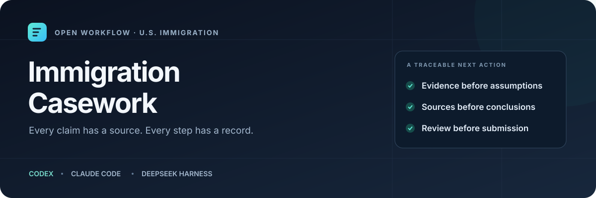

<p align="center"></p>

<p align="center">
  <a href="LICENSE"></a>
  
  
</p>

<p align="center"><strong>A portable agent skill for turning scattered notices into a traceable case file.</strong><br>Codex · Claude Code · DeepSeek Harness</p>

<p align="center"><a href="README.es.md">Español</a> · <a href="#install">Install</a> · <a href="examples/prompts.en.md">Examples</a> · <a href="docs/compatibility.md">Compatibility & limits</a> · <a href="CONTRIBUTING.md">Contribute</a></p>

Immigration Casework gives your AI agent a repeatable workflow for researching U.S. immigration questions, separating verified evidence from assumptions, organizing documents, and preparing a concrete next action. It focuses on family petitions and consular cases, with specialist handoffs for issues outside that scope.

It is an AI research and preparation tool, not a law firm or licensed representative. It does not guarantee outcomes, submit forms, sign documents, or provide private access to government systems.

## v2.1 Ruta Consular Telegram and DS-260

The [Cloudflare adapter 2.1.2](integrations/telegram/cloudflare/README.md) adds an authenticated webhook, one SQLite Durable Object per private chat, durable alarms and a privacy page. It hosts the bot without an always-on computer or VPS. Secrets and webhook activation are explicit; pending updates are preserved. It does not migrate private case files or activate an account when the skill is installed. Availability remains subject to operators, providers and account limits.

The optional [Ruta Consular Telegram service](integrations/telegram/README.md) adds public private-chat access to personal tasks, opt-in reminders and guided B1/B2 or immigrant interview practice. Profile/menu/photo setup and verification are explicit commands. A valid bot token and a continuously running host are required; neither is bundled or activated on installation. The default bot uses deterministic practice, not a generative model, and does not download identity documents or fill applications in chat.

[DS-260 and document preparation](skills/us-immigration-casework/references/ds260-and-documents.md) adds a private worksheet with per-field evidence/confirmation checks, draft exports and optional PDF text AcroForm/Word placeholder filling. It is not the complete conditional CEAC form and does not sign or submit. Scanned PDFs, unsupported controls, signed/active-content files and complex Word layouts need an appropriate separate workflow. Required optional packages: `pypdf` for fillable PDF, `python-docx` for Word, and existing export dependencies for report formats.

```bash
python3 skills/us-immigration-casework/scripts/forms.py review --input /private/case/ds260.json
python3 skills/us-immigration-casework/scripts/forms.py export --input /private/case/ds260.json --out /private/case/ds260-draft
```

Read the [Telegram workflow](skills/us-immigration-casework/references/telegram-public-bot.md), [deployment steps](integrations/telegram/README.md), [command menu](integrations/telegram/commands.txt) and [privacy-policy template](integrations/telegram/PRIVACY.template.md). Keep the token in the server's secret environment/file. The Docker guide requires a real operator contact and published privacy policy. Tests use simulated Telegram transport; profile configuration does not prove a running service or notification delivery. The Docker image must be built and tested on the deployment host; it was not built in this development environment.

## v2.0 Optional integrations calendar and collaboration

Work offline with private ICS exports and a local SQLite coordination ledger, then use an explicitly authorized host connector when available. Installation connects no accounts and activates no notifications.

| Capability | Included | Boundary |
| --- | --- | --- |
| Optional adapters | Google Calendar, timed Outlook Calendar, Gmail/Outlook draft and existing-draft send, one-time self reminders | Payload generation and host dispatch protocol; authenticated tools execute live actions |
| Calendar | UTC ICS, IANA offset checks, all-day dates, display alarms, stable UID and SEQUENCE | No automatic calendar import, legal deadline calculation or guaranteed alarm delivery |
| Notifications | Due queue, bound authorization, preflight, receipts and deduplication | No built-in daemon, SMS, WhatsApp or automatic retries after uncertain outcomes |
| Professional review | Case roles, tasks, independent review, version hashes and conflict checks | Local workflow records; not identity verification, tenant security or a shared web app |

Read [connectors and hosts](skills/us-immigration-casework/references/connectors-and-hosts.md), [calendar and notifications](skills/us-immigration-casework/references/calendar-and-notifications.md), [professional collaboration](skills/us-immigration-casework/references/professional-collaboration.md) and the [command contract](skills/us-immigration-casework/references/coordination-tools.md).

```bash
python3 skills/us-immigration-casework/scripts/agenda.py --input /private/case/calendar-events.json --out /private/case/calendar-001 --generated-at 2026-10-31T15:00:00Z
python3 skills/us-immigration-casework/scripts/coordination.py init --out /private/case/team --owner case-owner --now 2026-10-31T15:00:00Z
python3 skills/us-immigration-casework/scripts/coordination.py apply --db /private/case/team/coordination.sqlite3 --input /private/case/operation.json --now 2026-10-31T15:00:00Z
python3 skills/us-immigration-casework/scripts/coordination.py status --db /private/case/team/coordination.sqlite3 --now 2026-10-31T15:00:00Z
```

Copy the synthetic calendar/operation templates to a private workspace and use the actual current time. IANA timezones may need the optional `tzdata` package (`python3 -m pip install tzdata`), particularly on Windows. The installer does not install it. Exact existing user authorization can be recorded without asking again; a local authorization flag does not create consent. Read back actual provider state before claiming scheduling or sending. The deterministic suite uses synthetic ledgers and mock capability maps, never live mail or calendar writes. Native host connector execution is not covered by that suite.

Upgrade by reviewing the checkout and using `python3 scripts/install.py --target all --replace`; existing installed copies are backed up. v1.x private case manifests require no automatic migration. Coordination data stays outside the installed skill and public repository. The SQLite ledger is plaintext and not a distributed access-control system; the hash chain is not externally anchored or tamper-proof. Provider account permissions and encryption remain separate responsibilities.

## v1.2 DS-160 documents and refusal review

Prepare a sourced DS-160 worksheet, compare dates and applicant confirmations, extract scanned documents locally, preserve refusal grounds, and build a curated draft package. The worksheet screens selected fields; it is not the complete conditional CEAC form or a submission service. OCR always starts unverified. Refusal routing does not decide eligibility or infer the officer's reasoning.

| Module | Workflow | Optional local dependency |
| --- | --- | --- |
| DS-160 | [Worksheet and review](skills/us-immigration-casework/references/ds160-preparation.md) | None |
| OCR | [Page and token provenance](skills/us-immigration-casework/references/document-ocr.md) | Tesseract; Poppler for PDF; installed language data |
| Refusals | [214(b), 221(g), other/mixed grounds](skills/us-immigration-casework/references/refusal-analysis.md) | None |
| Exports | [MD, HTML, JSON, ZIP; optional PDF/DOCX](skills/us-immigration-casework/references/export-packages.md) | ReportLab for PDF; python-docx for DOCX |

```bash
python3 skills/us-immigration-casework/scripts/preparation.py ds160 --input /private/case/ds160.json --as-of 2026-10-31
python3 skills/us-immigration-casework/scripts/preparation.py refusal --input /private/case/refusal.json
python3 skills/us-immigration-casework/scripts/document_ocr.py --input /private/case/notice.pdf --out /private/case/ocr-001 --document-id E001 --language eng
python3 skills/us-immigration-casework/scripts/preparation.py export --input /private/case/packet.json --out /private/case/export-001
```

Copy the blank JSON templates from the skill's assets into a private workspace first; see the [command contract](skills/us-immigration-casework/references/preparation-tools.md). Optional PDF/DOCX: install `reportlab`/`python-docx` separately and use `--formats md html json pdf docx`. The skill installs no binaries or packages. OCR languages must already be available (`tesseract --list-langs`); `spa` is not bundled. ZIP exports are not encrypted or redacted and are never uploaded automatically. Core tests do not require these optional dependencies. The separate Ubuntu engine job installs them and runs synthetic OCR/PDF/DOCX smoke tests. Run that suite locally with `CASEWORK_INTEGRATION=1 python3 -m unittest discover -s tests -p test_document_integration.py -v`.

Example request: “Use us-immigration-casework to prepare my DS-160 worksheet, review the supplied refusal notice and export a draft packet for my attorney. Keep OCR uncertainties and missing facts visible.”

## What you get

| Capability | Practical result |
| --- | --- |
| Evidence-aware case reconstruction | Facts labeled as documented, user-reported, inferred, unverified, or contradicted |
| Stage and time analysis | Separate USCIS, NVC, consular, issuance, and admission steps; distinguish elapsed time from forecasts |
| Form and notice preparation | Field mapping, evidence indexes, RFE/NOID response organization, sourced deadline records |
| Humanitarian and institutional requests | Reviewable expedite, clinician-letter request, and congressional-inquiry drafts |
| Current-source workflow | Official-source ledger with sections, access method, checked date, and unresolved questions |
| Local tools | Private workspace creation, calendar arithmetic, consistency audit, domain classification, best-effort text redaction |

The skill loads detailed references only when needed. The Python tools use the standard library: no package installation, API key, telemetry, or network call is built into them. Your AI host and research tools have their own data handling and access requirements.

## Install

Review the files, then clone and install from a local checkout:

```bash
git clone https://github.com/EAdamesJ/immigration-casework.git
cd immigration-casework
python3 scripts/install.py --target all --dry-run
python3 scripts/install.py --target all
```

On Windows, use `py -3` instead of `python3` if that is your Python launcher. Python 3.10+ is needed for the optional scripts; the Markdown workflow itself has no Python dependency.

Install one target with `--target codex`, `--target claude`, or `--target deepseek`. For a project-scoped copy:

```bash
python3 scripts/install.py --target codex --scope project --project-root /absolute/path/to/project
```

| Target | User installation | Project installation |
| --- | --- | --- |
| Codex | `~/.agents/skills/us-immigration-casework/` | `.agents/skills/us-immigration-casework/` |
| Claude Code | `~/.claude/skills/us-immigration-casework/` | `.claude/skills/us-immigration-casework/` |
| DeepSeek Harness | `${DSH_HOME:-~/.dsh}/skills/us-immigration-casework/` | `.dsh/skills/us-immigration-casework/` |

The installer copies local files, changes no host configuration, and does not install an agent application. It refuses conflicting copies unless `--replace` is used; replacement keeps the previous directory outside the skill scanner. Reinstalling identical files leaves them unchanged. Review the printed destination before installing. Each target is updated separately; the multi-target operation is not a cross-directory transaction.

For manual installation, copy the complete `skills/us-immigration-casework/` directory to the appropriate skill root. The repository also includes skill-only Codex and Claude plugin manifests; the local-copy installer is the tested primary path. Claude chat/Cowork and cloud-managed Codex installations use their own account installation mechanisms; a local copy does not install a skill on another device. See [compatibility](docs/compatibility.md).

## Use

In Codex:

```text
Use $us-immigration-casework to organize my I-130 documents, identify
unresolved facts, and prepare the next action. Distinguish supplied
information from anything you verify directly.
```

In Claude Code:

```text
/us-immigration-casework Review these notices and build a sourced
timeline, evidence gaps, and a draft response plan.
```

In DeepSeek Harness, select the skill in the skill UI, or ask the agent to use the skill named `us-immigration-casework`. The filesystem skill provider must be enabled. No plugin configuration is silently changed by this repository.

Spanish works too:

```text
Usa la skill us-immigration-casework para revisar mi expediente.
Prioriza los plazos, identifica contradicciones y prepara los borradores
que puedas completar. Marca claramente qué falta verificar.
```

Start with the request and relevant notices. Provide only necessary data, redact unrelated identifiers, and use the host's secure authentication flow for accounts. Store actual case files outside this public repository and outside the installed skill.

## A useful output has an evidence trail

This abbreviated example is entirely synthetic:

| Finding | Evidence status | Next action |
| --- | --- | --- |
| Receipt date appears in the supplied notice excerpt | Document-based, not a live portal check | Preserve the source/page reference |
| A claimed consular interview conflicts with a still-pending USCIS stage | Contradicted | Obtain the interview notice and current decision history |
| No response deadline was supplied | Unverified | Inspect all pages before calculating or advising a response |
| Possible urgent support need | User-reported | Request current supporting documents; leave medical conclusions to the clinician |

The agent should produce a usable draft or a precise blocked step, rather than a confident story unsupported by the record. See [English prompts](examples/prompts.en.md), [Spanish prompts](examples/prompts.es.md), and [synthetic intake](examples/synthetic/intake.md).

## Local tools

Run from this checkout; after installation, resolve the installed skill directory instead:

```bash
python3 skills/us-immigration-casework/scripts/casework.py wait --received 2024-01-31 --as-of 2024-03-01
python3 skills/us-immigration-casework/scripts/casework.py source --url https://www.uscis.gov/forms
python3 skills/us-immigration-casework/scripts/casework.py init --out /private/path/case-001 --case-id case-001 --language es
python3 skills/us-immigration-casework/scripts/casework.py audit --case /private/path/case-001/case.json
python3 skills/us-immigration-casework/scripts/casework.py redact --input /private/path/note.txt --output /private/path/note-redacted.txt
```

- `wait` computes elapsed time using a documented calendar convention. It does not calculate legal deadlines or predict approval.
- `source` identifies an allowlisted official-domain candidate. It does not fetch, authenticate, or date the page.
- `audit` checks the bundled schema and selected references/chronology/stage rules. A clean audit is not legal review or document authentication.
- `redact` masks common receipt/A-number, SSN, email, and North American phone patterns in text. It misses other personal information and requires manual review.
- `init` creates a private skeleton and refuses existing outputs, symlink paths, and Git workspaces. POSIX permissions are restricted; encryption and Windows ACLs remain the user's responsibility.

See the [output contract](skills/us-immigration-casework/references/output-contract.md) for schema and exit codes.

## Quality and boundaries

Run the deterministic suite and package checks without a model or network:

```bash
python3 -m unittest discover -s tests -v
python3 scripts/validate_repo.py
```

GitHub Actions defines Linux/macOS/Windows checks. Native Codex, Claude Code, and DeepSeek model sessions are not executed by the unit suite. Compatibility means a researched skill format plus tested local-copy paths, not identical model behavior. The [evaluation guide](evals/README.md) separates behavioral review from deterministic tests.

There are no portal scrapers, hidden hooks, automatic submissions, built-in credentials, hardcoded current fees, or approval predictions. Current legal requirements must be researched when used. Core workflows include truthfulness, human signatures, source checks, appropriate consent, and professional review for material legal issues.

## Contribute

Useful contributions include reproducible synthetic cases, better bilingual templates, source-policy improvements, accessibility, and verified compatibility reports. Never attach a real case file to an issue or pull request. Read [CONTRIBUTING.md](CONTRIBUTING.md), [SECURITY.md](SECURITY.md), and the [maintainer guide](docs/maintainer-guide.md).

Created by [JeyTid](https://github.com/EAdamesJ). Distributed under the [MIT license](LICENSE). Independent project; no government or AI-vendor endorsement is implied.

## v1.1 — Visitor preparation / Preparación B1/B2

B1/B2 intake, qualitative preparation coverage, adaptive interview practice in English/Spanish, and personalized Visa Bulletin comparisons are included. Read the [visitor workflow](skills/us-immigration-casework/references/visitor-preparation.md), [interview guide](skills/us-immigration-casework/references/interview-simulator.md), [bulletin guide](skills/us-immigration-casework/references/visa-bulletin.md) and [local command contract](skills/us-immigration-casework/references/visitor-tools.md). Preparation is not approval probability; bulletin snapshots require current official-source verification.
